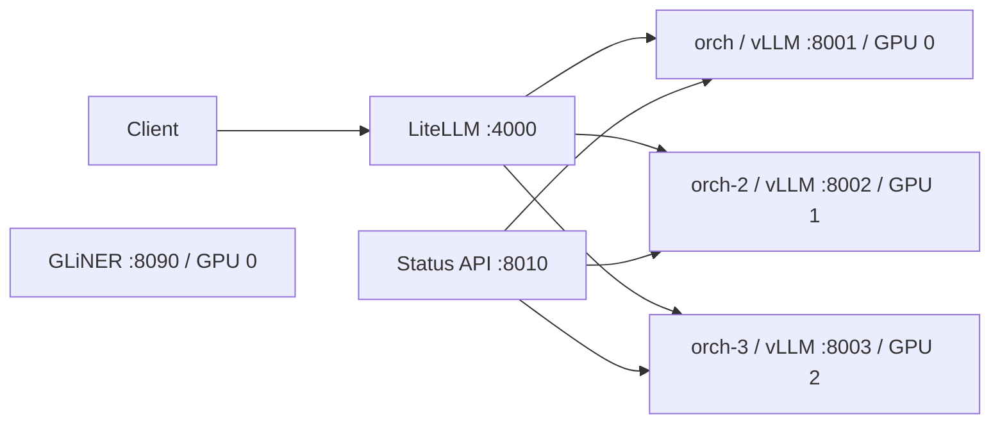

# Local LLM serving on Slurm

Serves LLMs on a Slurm GPU allocation. vLLM runs each model on its own GPU, bound to 127.0.0.1;
LiteLLM is the single OpenAI-compatible gateway; a status API reports each model's load. A
supervisor starts everything in order, restarts what crashes, and stops it all cleanly on `scancel`.



## Quick start (Webis gammaweb)

```sh
cd ~/thesis/thesis-research-agent/llm-setup
squeue -u "$USER"                         # avoid a duplicate stack (submit.sh also refuses one)
# Create .env from .env.example only if it does not already exist; set LITELLM_MASTER_KEY.
slurm/submit.sh --node <node>             # thesis stack: 3 orch replicas + GLiNER on GPU 0
# Record the job ID printed by submit.sh.
tail -f runtime/slurm-<jobid>.out
```

`submit.sh` does what the hand-typed `sbatch` used to: `--partition=gammaweb`, `gpu:ampere:3`,
the cluster Enroot container (`pytorch/pytorch:2.8.0-cuda12.9-cudnn9-runtime`, writable, root
remapped) and the compiler bootstrap, with `profiles/orch-gliner.yaml` (formerly
`orch-3x40-gliner.yaml`). It also refuses a second stack, checks the profile before the job
queues, and prints the commands to follow and stop it.

**Webis rules (the model cache):**

- Stay on Ampere (`gpu:ampere`); do not switch to Hopper.
- Pick the node with `--node <node>` where the pinned revisions are known to be cached; caches are
  node-local. Check the container's cache environment on that node first
  ([docs/OPERATIONS.md](docs/OPERATIONS.md#model-cache-webis) has the command).
- The institution provides `HF_HUB_CACHE`, `HF_DATASETS_CACHE` and `XDG_CACHE_HOME` inside the
  container. Never overwrite those variables, copy model weights into `/tmp`, or create a personal
  model cache. Nothing in this repository sets them; the model processes inherit them unchanged.
- The container bootstrap (a C compiler for Triton) is needed by this image and needs package
  repository access. The node-local Python environment (`.env`, `LLM_SETUP_LOCAL_ROOT`) is
  separate from the model cache.
- Offline mode is inherited: set `HF_HUB_OFFLINE=1` only when the required revisions and GLiNER's
  backbone tokenizer are already cached.

Common variants:

```sh
slurm/submit.sh --gpus 1 --profile profiles/orch.yaml      # one orch replica on one GPU
slurm/submit.sh --node gammaweb08                          # where the pinned weights are cached
slurm/submit.sh --job <jobid>                              # inside a GPU job you already hold
GLINER_PORT=8091 slurm/submit.sh                           # another user's server holds 8090
slurm/submit.sh --help
```

Stop with `scancel <jobid>` (the supervisor gets SIGTERM and stops every service).

## Profiles

| Profile | Serves | GPUs |
| --- | --- | --- |
| `profiles/orch.yaml` | `orch-model`, one replica per GPU | 1 or more |
| `profiles/orch-gliner.yaml` | the same, plus GLiNER on GPU 0 (the thesis stack, default) | 1 or more |
| `profiles/heavy-lite-embed.yaml` | `heavy-model`, `lite-model`, `qwen-embed`, one GPU each | 3 |

`gpus: all` in a profile means one replica on every GPU of the allocation, so `--gpus` alone
decides between one and three replicas. Format and capacity notes: [docs/PROFILES.md](docs/PROFILES.md).

## Using the stack

From the compute node (`srun --jobid <jobid> --overlap --pty bash -l`) or through an SSH tunnel
(`ssh -L 4000:127.0.0.1:4000 -L 8010:127.0.0.1:8010 <node>`):

```python
from openai import OpenAI
client = OpenAI(base_url="http://127.0.0.1:4000/v1", api_key="<LITELLM_MASTER_KEY>")
client.chat.completions.create(model="orch-model", messages=[{"role": "user", "content": "Hi"}])
```

- Call the gateway (`:4000/v1`) only, never a vLLM port. With several replicas, `orch-model` goes to
  the least busy one and `orch-model-1`, `-2`, `-3` pin one.
- `GET :8010/v1/status` gives `overall` and each model's `state` (healthy, busy, saturated,
  recovering, unavailable), `running`, `waiting` and `kvCache`; `GET :8010/v1/events` the supervisor's events.
- GLiNER: `GET :8090/info`, `POST :8090/predict` (see [docs/OPERATIONS.md](docs/OPERATIONS.md#gliner)).

## Commands on the compute node

```sh
uv run llm-setup doctor            # every check in order; names the first problem (--smoke: one request per model)
uv run llm-setup status            # each replica's state, load and KV cache
uv run llm-setup events            # starts, exits, restarts, stops
uv run llm-setup logs orch-2       # a service's log (also after a failed start)
uv run llm-setup stop              # stop the session from another shell
uv run llm-setup profile show --profile profiles/orch.yaml --gpus 3
```

## Layout

```
slurm/submit.sh        login node: submit a job, or start inside one (--job)
slurm/job.sh           inside the allocation: install on node-local scratch, run the supervisor
profiles/              what runs where
src/llm_setup/
  cli.py               the llm-setup command
  profile.py           profile loading (env vars, extends, gpus: all) and validation
  supervisor.py        start order, health waits, clean stop
  watchdog.py          restarts with back-off, health reports, SIGTERM handling
  vllm.py, gateway.py  vLLM command/environment and checks; the LiteLLM config
  runtime.py           runtime/<session>/: logs, events, process records (node-local in a job)
  mirror.py            copies the node-local session folder to runtime/ every minute
  process.py           session-owned processes only: marker, signals, GPU mapping
  status.py, metrics.py  the status API
  doctor.py            doctor and smoke checks
  gliner_server.py     the optional GLiNER HTTP service
docs/                  OPERATIONS (running it), PROFILES (configuring it), DEBUGGING (fixing it)
```

Tests run without a GPU: `uv run --extra dev pytest -q` and `uv run --extra dev ruff check .`.
