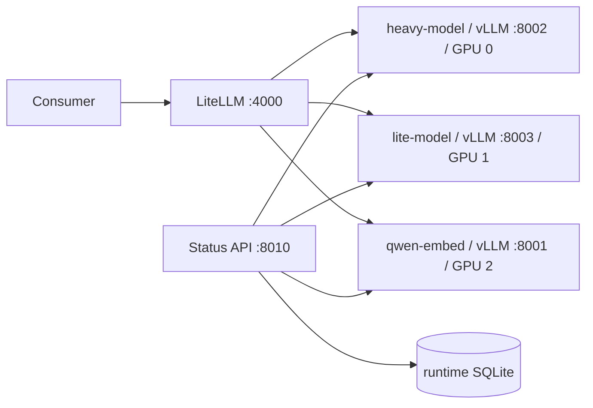

# Local LLM serving

This repository runs two chat models and one embedding model on a three-GPU Slurm allocation. vLLM serves each backend on loopback; LiteLLM is the only OpenAI-compatible gateway. The status API polls backend health and metrics and stores one day of compact samples in SQLite.



Heavy (`heavy-model`) handles quality schema inference, evidence review, and answer verification. Lite (`lite-model`) handles structured and EDC extraction, mapping, planning, and MCP control. Embed (`qwen-embed`) accepts embedding requests only.

## Webis quick start: three Ampere GPUs and GLiNER

For the thesis stack use `profiles/orch-3x40-gliner.yaml`: three Qwen replicas behind
`orch-model` and GLiNER on GPU 0. Each service listens on loopback. Check for existing
jobs first and use the cluster-provided Enroot environment:

```sh
cd ~/thesis/thesis-research-agent/llm-setup
squeue -u "$USER"                         # avoid a duplicate stack
# Create .env from .env.example only if it does not already exist; set LITELLM_MASTER_KEY.
LLM_SETUP_PROFILE=profiles/orch-3x40-gliner.yaml LLM_SETUP_BOOTSTRAP_COMPILER=1 \
  sbatch --partition=gammaweb --container-image=pytorch/pytorch:2.8.0-cuda12.9-cudnn9-runtime \
  --container-writable --container-remap-root slurm/llm-stack.sbatch
# Record the job ID printed by sbatch.
tail -f runtime/slurm-<jobid>.out
```

The script requests `gpu:ampere:3`; do not switch to Hopper. Select a node with
`--nodelist=<node>` when the pinned revisions are known to be available there. Check the
container's cache environment on the selected compute node first: the institution provides
`HF_HUB_CACHE`, `HF_DATASETS_CACHE` and `XDG_CACHE_HOME`. Never overwrite those variables,
copy model weights into `/tmp`, or create a personal model cache. The container bootstrap is
needed by the image used for the verified run and needs package repository access. A node-local
Python environment is separate from the model cache. Offline mode is inherited: use it only
when the required revisions and tokenizer are already cached.

Already holding a GPU job (for example an interactive `srun --gres=gpu:ampere:3 ... --pty bash`)?
Start the stack inside it instead of submitting a second job:

```sh
LLM_SETUP_PROFILE=profiles/orch-3x40-gliner.yaml slurm/start-in-job.sh <jobid>
tail -f runtime/slurm-<jobid>.out
```

Gammaweb nodes are shared: another user's server may already hold one of our ports (seen: a foreign
vLLM on 8090, GLiNER's default). `start` then stops with `ports already in use`. Do not stop their
process; move ours, e.g. `GLINER_PORT=8091` before the command above, and use that port in
`GLINER_URL`. Symptoms and fixes: [Debugging](docs/DEBUGGING.md).

For startup checks, first-run cache checks and recovery, see [Operations](docs/OPERATIONS.md)
and the parent repository's `docs/runbook-slurm.md` sections 0–0.3. Once ready:

```sh
srun --jobid <jobid> --overlap curl -s http://127.0.0.1:${GLINER_PORT:-8090}/info
srun --jobid <jobid> --overlap nvidia-smi --query-gpu=index,memory.used,memory.total --format=csv
```

The default `sbatch slurm/llm-stack.sbatch` uses the distinct heavy/lite/embed profile;
set `LLM_SETUP_PROFILE` as above for the thesis setup. Stop only the intended job with
`scancel <jobid>`. The job's Python environment and uv package cache use temporary scratch;
model weights stay in the cluster-configured Hugging Face cache.
